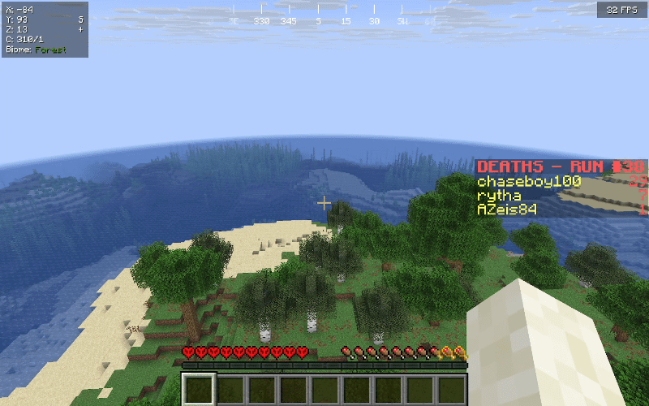

# WipeTogether

**A hardcore reset plugin for teams playing hardcore on Paper.** When one player dies, the whole team starts a fresh world together.

One death. A new world. Together.

> **Latest GitHub release: [WipeTogether 1.2.1](https://github.com/hildebrandchase/WipeTogether/releases/tag/v1.2.1)** — native hardcore mode, the vanilla death screen, and configurable titles and messages. Download the plugin JAR from the release's Assets section.

WipeTogether turns cooperative hardcore into a sequence of shared attempts: a death starts a countdown, moves everyone to a new random seed, and resets player progress. Death counts and completed-run records survive between attempts.

## See the reset in action

[](docs/assets/reset-demo.gif)

One player's death starts the countdown, then the team begins again in a fresh world. Click the animation to open it at full size.

## Features

- Fresh Overworld, Nether, and End for each attempt, with portals routed to the active run.
- A configurable death countdown, on-screen titles, chat messages, sidebar title, and TAB text, with built-in sounds.
- A TAB run timer that resumes after a normal restart and freezes on victory.
- Dragon victory celebration, harmless fireworks, and persistent team/time/seed records.
- Inventory, armor, ender chest, XP, potion effect, advancement, and recipe resets. Offline players catch up when they rejoin.
- Admin commands for fresh worlds, run numbers, and death counts.
- Strict configuration loading and atomic saves. Failed run-state saves retain the old worlds and retry before committing the reset.

This is a **server-wide team game mode**. All online players join the same run; it does not manage separate teams or exempt lobby worlds. Use a dedicated server and back up existing worlds and player data before installation. The plugin controls the sidebar and TAB header/footer, which can conflict with other plugins using those displays.

## Requirements

- Paper; the minimum API target is **1.21.4**. Spigot, Bukkit, and Folia are not supported targets.
- Java 21 to build. Run the server with the Java version required by your Paper release; Paper 26.3 requires Java 25.
- Recommended server settings: `difficulty=hard` and `hardcore=true`. WipeTogether keeps run worlds in hardcore mode and returns the team to survival for each new attempt.

The code includes legacy world-folder handling and Paper 26.1+ dimension storage handling. Compilation and automated tests do not certify every Paper release. See [testing and compatibility](docs/TESTING.md) for the exact validation scope.

## Install

You can install a release without IntelliJ, Maven, or compiling the source. You need an already working [Paper server](https://papermc.io/downloads/paper) that meets the requirements above. WipeTogether is installed on the server; players do not need a client mod.

### 1. Download the plugin

Open [GitHub Releases](https://github.com/hildebrandchase/WipeTogether/releases) and select the release you want to install. Expand **Assets** and download the `WipeTogether-<version>.jar` file, for example `WipeTogether-1.2.1.jar`.

The automatically generated **Source code (zip)** and **Source code (tar.gz)** downloads contain source files, not an installable plugin. If a release does not have a plugin JAR attached, choose a release that does or follow the build instructions below.

### 2. Prepare your server

Stop the server completely using `stop` in its console, or the stop button in your hosting panel. Back up the server's worlds, player data, and plugin configuration.

For the intended team hardcore rules, set these values in `server.properties` while the server is stopped:

```properties
difficulty=hard
hardcore=true
```

Keep vanilla hardcore enabled. The player who dies sees the normal Minecraft hardcore death screen and may choose **Spectate World** or **Title Screen**. When the countdown ends, a player still on the death screen is respawned, and everyone online is teleported into the next world and put in survival mode.

Leaving from the death screen or disconnecting after choosing **Spectate World** does not block the team reset. On returning after the reset, the player joins the current run in survival with their old-run inventory and progress cleared. Reconnecting before the countdown finishes leaves them in the old run until the transfer happens.

### 3. Install the JAR

Copy or upload the downloaded JAR into the **server's** `plugins/` folder. With a hosting panel, use its file manager or SFTP. Keep only one WipeTogether JAR installed and remove an older version's JAR when updating. Leave the plugin JAR intact; do not extract it or place it in your Minecraft client's `mods/` folder.

Your server folder should look similar to this:

```text
your-paper-server/
  plugins/
    WipeTogether-1.2.1.jar
  server.properties
  ...
```

If you are upgrading from HardcoreReset, follow the migration instructions below before starting the server.

### 4. Start and verify

Start the server normally. Check the console for WipeTogether's **Plugin loaded successfully** message and confirm that it appears when you run `plugins` in the console. If it fails to load, read the startup error before inviting players.

The first successful startup creates `plugins/WipeTogether/config.yml` and `plugins/WipeTogether/messages.yml`. Use `config.yml` for gameplay settings and `messages.yml` for titles, colors, and messages. Stop the server before editing and start it again afterward; do not use `/reload`.

### 5. Play together

Join the server with your team. You should see the death scoreboard and TAB run timer. When a player dies, the countdown begins and the whole team moves to a new world. Back up anything you want to keep before testing a death or using `/resetworld`.

On first installation, the current default world is the first run. Subsequent attempts use isolated fresh worlds. The default world and its default dimensions are retained; retired generated run worlds are removed after a successful reset.

### Hardcore hearts and upgrading from 1.2.0

Set `hardcore=true` in `server.properties`, install WipeTogether 1.2.1 or newer, and fully restart the server. Existing run worlds and retained default dimensions have their hardcore flags repaired without replacing terrain or clearing records. Reconnect after the restart so the client receives the corrected hardcore flag. No resource pack or additional plugin is needed for hardcore hearts.

The author has reported the hardcore reset and death-screen behavior working in gameplay. Automated tests also cover offline return and spectator paths. This is not a compatibility claim for every Paper version. If hearts remain normal, check the installed plugin version and any client resource packs or other plugins that alter the display.

### Update an existing WipeTogether installation

Stop the server and back up its data. Replace the old WipeTogether JAR with the new release's JAR, keeping `plugins/WipeTogether/` and the existing world folders. Start the server and check the console again. Do not delete the data folder to update: it stores the active run, death counts, timer, and win history.

### Upgrade from HardcoreReset

Stop the server, back up `plugins/HardcoreReset/`, remove the old HardcoreReset JAR, and install WipeTogether. If only the legacy data folder exists, WipeTogether renames it to `plugins/WipeTogether/` automatically. Saved run identity, world prefixes, death counts, player records, timers, and win history are kept. Existing world directories are not renamed.

If both data folders exist, startup stops instead of choosing one or overwriting records. Back up both and retain the intended configuration in `plugins/WipeTogether/`, then move the legacy folder outside `plugins/` before restarting. Never run both plugin JARs together.

The new permission is `wipetogether.admin`; existing `hardcorereset.admin` grants remain supported as a compatibility alias.

### Installation troubleshooting

| Problem | What to check |
| --- | --- |
| WipeTogether does not appear in `plugins` | Confirm you installed the release JAR in the running server's `plugins/` folder, restarted fully, and checked the console for load errors. |
| Java or unsupported API error | Confirm the server is Paper, meets the minimum API target, and uses the Java runtime required by its Paper version. |
| Startup reports both data folders | Follow the HardcoreReset migration instructions above; preserve both backups before selecting the intended data folder. |
| Invalid configuration error | Stop the server and correct the reported YAML syntax. Use spaces for indentation and preserve saved game records. |
| Admin commands say permission denied | Use the server console, an operator account, or grant `wipetogether.admin` through your permissions plugin. |

## Commands

All commands support console use and require `wipetogether.admin` (operators by default).

| Command | Behavior |
| --- | --- |
| `/resetworld` | Starts a fresh world using the countdown; keeps the run number and death counts. |
| `/resetruns` | Sets the displayed run number to 1; keeps the current world and timer. |
| `/setrun <number>` | Sets a positive run number; keeps the current world and timer. |
| `/setdeaths <player> <number>` | Sets a nonnegative death count for an online or known offline player. |
| `/resetdeaths` | Clears all recorded death counts. |

A death-triggered reset increments the run number. Run-number edits and additional resets are blocked while a reset is already in progress.

## Configuration

The settings are organized into two files, with saved player/run data kept out of the presentation file:

| File | What to change |
| --- | --- |
| `plugins/WipeTogether/config.yml` | Countdown duration, standby delay, world prefixes. Preserve saved data below the marked divider. |
| `plugins/WipeTogether/messages.yml` | Chat announcements, five title styles and their timings, scoreboard title, TAB text, and admin feedback. |

**[Open the settings guide →](docs/SETTINGS.md)** for examples, placeholder tables, and troubleshooting. The files also contain a quick-start guide and comments next to each group of options.

Edit settings while the server is stopped. For example, gameplay settings in `config.yml`:

```yaml
settings:
  world-prefix: "wipetogether_world_"
  standby-prefix: "wipetogether_standby_"
  countdown-seconds: 3
  cooldown-before-standby-prep-seconds: 15
```

Countdown duration has a minimum of one second; standby preparation delay has a minimum of five seconds. Standby prefixes must use letters, numbers, underscores, or hyphens, with a maximum of 80 characters. Preserve migrated world prefixes on existing installations.

For a custom welcome title, edit the existing `titles.welcome` group in `messages.yml`:

```yaml
titles:
  welcome:
    enabled: true
    title: '<gold><bold>Attempt #<run></bold></gold>'
    subtitle: '<gray>Stay together. Survive together.</gray>'
    fade-in-ms: 200
    stay-ms: 3000
    fade-out-ms: 500
```

Text uses MiniMessage formatting: close color/style tags as shown. Timings are milliseconds (`1000` = one second), from `0` to `60000`. Set `enabled: false` to hide a title or use `''` to hide an individual chat message. These choices do not disable resets, timers, records, sounds, or fireworks. The vanilla hardcore death screen is unchanged.

`messages.yml` is created automatically on upgrade. Missing options use defaults without replacing custom text. Invalid text types, formatting, or timing values log a warning and fall back to defaults for that option. Invalid YAML prevents plugin startup and preserves the file for correction. No additional plugin or resource pack is needed.

`state`, `players`, `deaths`, and `wins` contain persistent game data. Leave internal state fields alone during normal use. If the saved active world is genuinely missing, the plugin creates a replacement at the same run number, resets the current timer/victory state, and retains historical deaths and wins.

Malformed YAML stops startup without rewriting the file. Correct the reported configuration problem and restart. If a reset cannot save its new state, it retains the old worlds and retries every five seconds; correct the disk-space or permissions problem before continuing. Atomic file replacement must be supported by the server filesystem.

## Winning a run

Defeat the active run's Ender Dragon, then enter the End exit portal. The first return completes the run once, freezes the timer, and records the run number, seed, final time, completion timestamp, first returner, and team members under `wins.<world-name>`. End gateways and other worlds' dragons do not count.

Victory does not prevent later deaths or automatically start another attempt. A subsequent death starts a new run; `/resetworld` starts a fresh world while keeping the displayed run number.

## Development

### Build from source

With JDK 21 and Maven 3.9+ installed, run this command from the folder containing `pom.xml`:

```shell
mvn clean verify
```

In IntelliJ IDEA, open **View → Tool Windows → Maven**, expand **WipeTogether → Lifecycle**, run **clean**, and then run **verify**. If Maven is missing from the menu, right-click `pom.xml` in the Project panel and select **Add as Maven Project**. IntelliJ's bundled Maven is sufficient; select JDK 21 for the Maven runner.

Wait for `BUILD SUCCESS`. The current version builds `target/WipeTogether-1.2.1.jar`; install that file using the steps above. Paper is provided by the server, and test dependencies are not bundled. GitHub Actions also runs verification and uploads a build artifact; extract its ZIP to obtain the plugin JAR.

See [START-HERE.md](START-HERE.md), [CHANGELOG.md](CHANGELOG.md), and [testing](docs/TESTING.md). This repository contains the project's original source.

## License

WipeTogether is available under the [MIT License](LICENSE).
